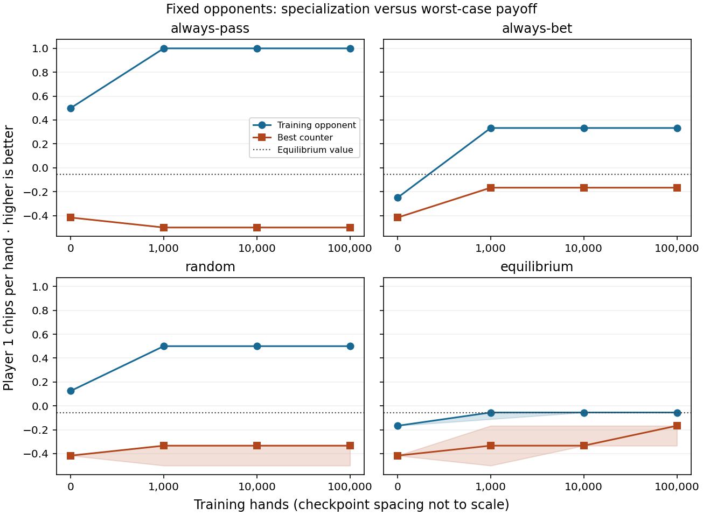
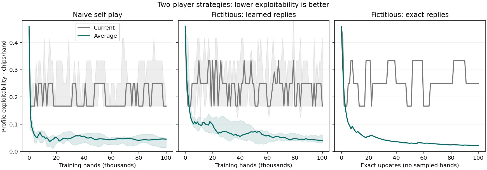

# Evaluation and self-play in two-player Kuhn poker

Does a learner get better at poker, or just better at beating its training partner? We test both. Fixed-opponent runs score one player's frozen policy against its training bot **and** its strongest legal counter. Self-play runs score the **pair** of policies by exploitability: zero means neither player gains by changing strategy alone.

## Comparison only: Kevin's fixed-opponent learning curves

The figure and table in this section come from Kevin's six-information-set comparison learner (`q_learning.py`, via `fixed_curve.py`). They are **not** results from Brian's [main fixed-opponent learner](https://github.com/dwu0501/CSE150A-Project/pull/3), which uses two forced actions and trains against three values of `q`.



Lines are medians over seeds 0–4; shading is the full seed range, not a confidence interval. Each of the 20 runs uses one uninterrupted trajectory. At 0, 1,000, 10,000 and 100,000 hands we save the same learner's six action probabilities, turn exploration off, and evaluate both payoffs exactly over the six possible deals. Zero hands is the untrained 50/50 baseline. [Per-seed policies and scores](results/fixed.json).

Against **always-pass**, training raises the median from +0.50 to +1.00 chips/hand by 1,000 hands, but lowers its worst-case payoff from −0.417 to −0.500. Against **equilibrium**, the median training payoff has already reached its ceiling by 1,000 hands, while the median worst-case payoff improves from −0.333 at 1,000 to −0.167 at 100,000. The two curves answer different questions.

| Training P2 | Untrained vs P2 | Trained vs P2 | Best possible vs P2 | Trained vs best counter | P1 security gap |
| --- | ---: | ---: | ---: | ---: | ---: |
| Always-pass (check/fold) | +0.5000 | +1.0000 | +1.0000 | −0.5000 | 0.4444 |
| Always-bet (bet/call) | −0.2500 | +0.3333 | +0.3333 | −0.1667 | 0.1111 |
| Random | +0.1250 | +0.5000 | +0.5000 | −0.3333 | 0.2778 |
| Equilibrium | −0.1667 | −0.0556 | −0.0556 | −0.1667 | 0.1111 |

Trained entries are medians after 100,000 hands; units are P1 chips per hand. All five seeds attained the exact best-response payoff against each training opponent. Against random, three policies earned −1/3 against their strongest counter and two earned −1/2. Against equilibrium, reaching −1/18 is the best possible **response**, not exploitation of the equilibrium opponent.

## Self-play: profile exploitability (lower is better)



Lines are medians and bands are min–max across the same five seed IDs for the sampled methods. The exact reference is deterministic. [Per-round current and average policies and scores](results/selfplay.json). Initial exploitability: **0.45833** for the uniform pair.

| Method | Budget | Final current | Final average | Final average range |
| --- | --- | ---: | ---: | ---: |
| Naïve self-play | 100,000 joint hands per seed | 0.16667 | 0.04526 | 0.01509–0.04974 |
| Fictitious play, Q-learned replies | 100,000 total hands per seed | 0.16667 | 0.04043 | 0.03259–0.06229 |
| Fictitious play, exact replies | 100 full-tree update rounds; no sampled hands | 0.25000 | 0.02145 | deterministic |

Averaging reduced final exploitability for both sampled methods. Their five-seed ranges overlap; these runs do not establish a winner or convergence to zero. The exact reference isolates the effect of replacing the learned reply with an exact one; an exact update is **not** a sampled-hand budget.

### How training works

- **Comparison learner (`q_learning.py`):** P1 observes its own card and betting history. Six information sets × two legal actions; all Q-values start at zero. Training uses ε-greedy exploration (ε = 0.2), discount 1, a step size of 1/visits and terminal net chips; an intermediate check-bet bootstraps from the next state. Evaluation freezes the greedy policy and splits exact ties equally.
- **Naïve (`self_play.py`):** both seats have their own Q-table. They act with exploration against each other's current learner, then update from the same hand with opposite terminal rewards. Save current greedy policies every 1,000 hands and also evaluate the mixture of the pre-hand greedy policies, without exploration.
- **Fictitious, learned:** start each average with one uniform policy. Freeze *both* averages at the start of each round. Train a fresh Q-table per seat for 500 hands against the other seat's frozen average; add both new greedy replies simultaneously with equal historical weight. One round therefore spends 1,000 sampled hands, not 1,000 per seat.
- **Fictitious, exact:** same initialization and averaging rule, but compute each best reply exactly using `common/evaluate.py`. No sampled hands or exploration. For both versions the average represents mixing complete policies: P1's call frequency after checking a given card is weighted by how often each historical policy would have checked that card. Method reference: Heinrich, Lanctot & Silver, *Fictitious Self-Play in Extensive-Form Games* (ICML 2015).

## Reproduce

From the repo root (not this folder), use Python 3.10+ in a virtual environment. Training and JSON export use only the standard library. Matplotlib is needed only to redraw the figures; OpenSpiel is an optional independent test.

```sh
python -m pip install matplotlib==3.10.6   # omit for --data-only
python -m self_play.fixed_curve          # self_play/results/fixed.{json,png}
python -m self_play.self_curve           # self_play/results/selfplay.{json,png}
# Independent runs or other budgets (use --out to keep the checked-in results)
python -m self_play.self_curve --rounds 10 --batch 200 --seeds 0 1 --data-only --out my-results
python -m self_play.q_learning --opponent random --episodes 100000 --seeds 0
python -m self_play.q_learning --opponent all --episodes 100000 --epsilon 0.2 --seeds 0 1 2 3 4
python -m unittest discover -t . -s self_play -v
# For the independent cross-check, install open-spiel==2.0.2 and rerun the suite.
```

## Scoring a policy and checking the hill-climbing baseline

`hill_climbing/hill_climbing.py` preserves the original **hill-climbing baseline**. It adjusts four P1 probabilities in steps of 0.005 against a fixed equilibrium P2. Its simulation sanity-checks its expected payoff; agreement with −1/18 against that opponent is **not** an equilibrium test. The first logged policy scores **−0.05556** against that P2 but **−0.18833** against its strongest counter. Across 10,000 rounded logged policies the median worst-case payoff is **−0.23733**. Keep the simulator and logs as a comparison, not a success criterion.

```sh
python -m common.evaluate policy --p1 .406 0 .740 .341
python -m common.evaluate policy --p1 .406 0 .740 .341 --p2 .5 .5 .5 .5 .5 .5
python -m common.evaluate log hill_climbing/logs/log.txt
```

Policies have six probabilities per seat: bets with J/Q/K then calls with J/Q/K. P1 bets when opening and calls after check-bet; P2 bets after a check and calls against an opening bet. The four-number legacy P1 format is also accepted. A best reply sees its own card and public actions, never the hidden deal. Tests check both replies against all 64 deterministic strategies per seat and compare scores with OpenSpiel.

| Evaluator output | Meaning (all payoffs use P1's sign) |
| --- | --- |
| `p1_ev` | Expected payoff when neither supplied policy changes. |
| `p1_worst_case_ev` | Payoff if P2 switches to its best counter. |
| `p1_security_gap` | Game value (−1/18) minus that worst-case payoff; zero means P1 guarantees the game value. |
| `p1_best_response_ev` | Best payoff P1 can achieve against the supplied P2. |
| `nash_conv`, `profile_exploitability` | Difference between P1 best-response and worst-case payoff, and half that difference, respectively; both measure the **pair**. |
